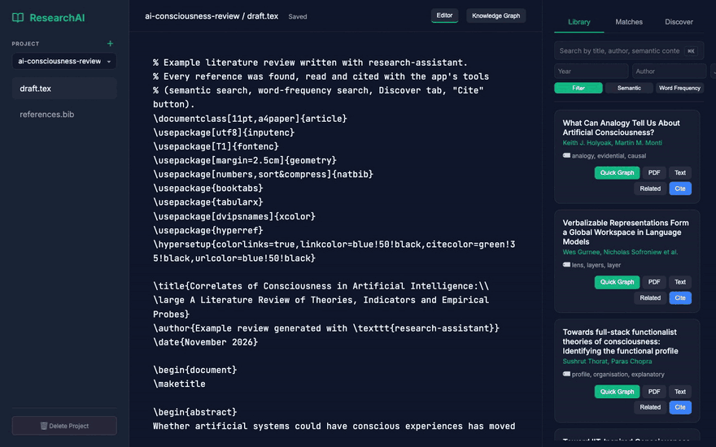
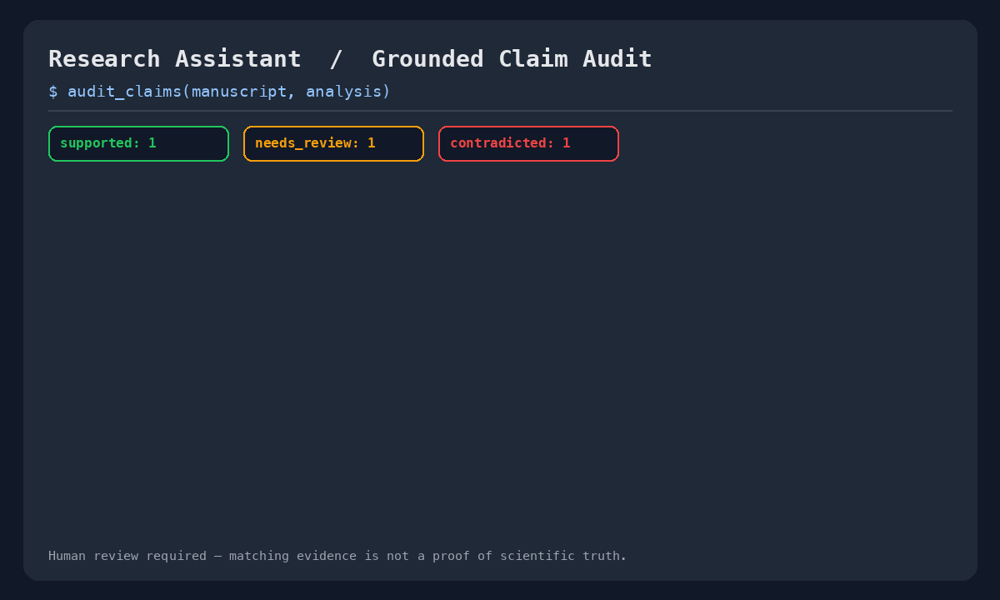

# 🔬 Research Assistant

> A self-hosted, privacy-focused, AI-powered research workstation: PDF library management with Zotero import and Crossref metadata extraction, a semantic and citation graph of your papers (UMAP + Semantic Scholar), and a simple LaTeX draft editor with citation search.

[](https://www.python.org/downloads/)
[](https://fastapi.tiangolo.com/)
[](https://opensource.org/licenses/MIT)



**New here? Follow the [illustrated tutorial](tutorial.md)** — it builds a 39-paper library on consciousness in AI and uses it to write an [example literature review](docs/examples/ai-consciousness-review/review.pdf).

---

## 🚀 Quickstart in 3 Steps

### 1. Set Up Environment

```bash
# Clone the repository
git clone https://github.com/jobellet/research-assistant.git
cd research-assistant

# Create and activate conda environment
conda env create -f environment.yml
conda activate ai_research_assistant
```

*(Optional)* Set your Hugging Face token for the Matryoshka `google/embeddinggemma-300m` embedding model:
```bash
export HF_TOKEN="your_huggingface_token"
```

---

### 2. Import Your Paper Library

Choose whichever method best fits your existing workflow:

- 📦 **Zotero Library (1-Command Auto-Import)**:
  ```bash
  python scripts/import_zotero.py
  ```
  *Auto-detects `~/Zotero/storage`, calculates SHA-256 hashes for zero-duplicate ingestion, fetches metadata from Crossref, and builds the ChromaDB index.*

- 📂 **Local Inbox Folder**:
  Drop any scientific PDF into `inbox/`, then start the pipeline with **Run Process** in the Backend Monitor (`/dashboard`) or `POST /api/process/start`. It hashes the file, moves it to `library/<hash>/`, extracts text and verified metadata (arXiv / Crossref), builds the word index and keywords, computes embeddings and refreshes the knowledge graph. While running, it checks `inbox/` every few seconds.

- 🌐 **Online search (Discover)**:
  Search arXiv, OpenAlex and Semantic Scholar from the **Discover** tab or `python -m discovery_module search "..."`, and add open-access papers to the inbox in one click. To get the tutorial's demo library: `python scripts/fetch_demo_library.py`.

- ☁️ **Google Drive**:
  Run `python scripts/gdrive_sync.py <folder_id>` (or set `GDRIVE_FOLDER_ID`) to mirror a publicly shared Drive folder into `inbox/`.

---

### 3. Launch the Workstation

Start the local server:
```bash
python -m server_module.main
```

Open your browser and navigate to:
👉 **`http://localhost:8000/ui`**

*(On macOS, you can also simply double-click `launch.command` in Finder).*

---

## ✨ Core Features

- ✍️ **Web-Based LaTeX Draft Editor**: A plain-text editor in the browser that saves per project to `projects/<name>/draft.tex`. It does not compile LaTeX or preview PDFs.
- 🔍 **Highlight-to-Search**: Select any sentence, hypothesis, or paragraph in your LaTeX draft to search your local library with semantic vector search or Bag-of-Words keyword matching (selected per query, not combined).
- 📌 **1-Click BibTeX Injection**: Click **Cite** on any paper to add a clean BibTeX entry (authors, year, DOI, journal or arXiv eprint; no duplicates) to the project's `references.bib` and get its `\cite{key}`.
- 💬 **Ask Your Library**: Questions answered from your own papers, with citations, using any AI provider with an API key (OpenAI, Gemini, Claude, Mistral, Groq, OpenRouter) or a local Ollama server — no cluster needed.
- 🔌 **MCP server**: let Gemini (or any MCP client) search the literature and, optionally, your private library, read-only, through a Cloudflare tunnel. See [docs/mcp.md](docs/mcp.md).
- 📱 **Laptop ↔ Phone**: Projects sync through a private Google Drive app folder; the same page on GitHub Pages works on a phone without the server (write, browse and cite the library, search online). See [docs/sync-and-ai.md](docs/sync-and-ai.md).
- 🌐 **Literature Discovery**: Search arXiv, OpenAlex, Semantic Scholar and Crossref at once, find papers related to a library paper or to a highlighted passage, see which results you already have, and download open-access PDFs into the library.
- 🕸️ **Interactive Semantic Knowledge Graph**: Explore literature clusters in 2D using UMAP embeddings and visualize citation connections powered by Semantic Scholar.
- 📎 **Supplementary & Multi-File PDF Grouping**: Automatically clusters main papers and supplementary materials by DOI so you can view all associated files from a single card.
- 🛡️ **Grounded Claim Audit**: Compares each substantive manuscript sentence against supplied analysis/results text, flags unsupported or numerically conflicting claims, and returns the best evidence sentence for human review. It runs locally and never asks an LLM to fabricate evidence.
- 📊 **Grant Proposal & Manuscript QC Toolkit**: Built-in automated checks for prose style, voice balance, quantity consistency, grant timeline horizons, and DFG-style Gantt Work Schedule table generation.

---

## 💻 Handy CLI Utilities

| Command | Description |
| :--- | :--- |
| `python scripts/import_zotero.py` | Auto-detect and import all papers from local Zotero storage into library and ChromaDB. |
| `python -m discovery_module search "query"` | Search arXiv/OpenAlex/Semantic Scholar; also `related <id>`, `text "<passage>"`, `fetch <arXiv id or DOI>`. |
| `python scripts/fetch_demo_library.py` | Download the tutorial's 39-paper demo library into `inbox/`. |
| `python scripts/generate_bow.py` | Rebuild the word-frequency index and TF-IDF keywords (automatic after processing). |
| `python -m audit_module.prose_auditor draft.txt` | Audit manuscript/grant text for AI connectives, empty negatives, voice, rhythm & spellings. |
| `python -m audit_module.number_auditor draft.txt --horizon 36` | Audit quantity agreement, grant timeline horizon bounds, sum checks ($a+b=c$), and ranges. |
| `python -c 'from audit_module import audit_claims; print(audit_claims("Draft claim.", "Analysis evidence."))'` | Compare draft claims with supplied analysis text; use `POST /api/audit/claims` for the authenticated API. |
| `python -m toolkit_module.schedule_generator` | Generate DFG-style Work Schedule Gantt chart PNG image for proposal submission. |
| `python -m toolkit_module.pdf_comments file.pdf` | Extract reviewer annotations and baked-in Word margin text comments from PDF. |
| `python -m toolkit_module.figure_fit fig.png` | Calculate exact figure page height fraction and text column scaling. |
| `python run_search.py` | Launch interactive desktop Tkinter search GUI. |
| `python scripts/search_bow.py "keyword"` | Perform instant Bag-of-Words keyword search on paper index without vector model overhead. |
| `python scripts/build_graph.py` | Pre-compute 2D UMAP projection and citation network cache (`library/graph_cache.json`). |
| `python test_grant_toolkit_integration.py` | Run integration test suite for auditing, schedule rendering, and docx tools. |
| `python test_search.py` | Run semantic vector search and path-traversal security test suite. |

---

## 🛡️ Grounded Claim Audit Demo

The audit compares a draft with the analysis text supplied to it. It identifies claims with matching evidence, prioritizes absolute statements for review, and detects conflicting numerical values. The matching evidence supports a reviewer’s decision; it does not itself prove scientific truth.



Regenerate the animated GIF locally with:

```bash
python scripts/record_claim_audit_demo.py --output /tmp/claim-audit-demo.gif
```

The generated demo uses real `audit_claims` output: one supported claim, one absolute claim requiring review, and one numerical contradiction.

---

## 📖 In-Depth Tutorial

See the illustrated **[tutorial](tutorial.md)**: installation, building a library, highlight-to-search and citing, the three library search modes, online discovery, Quick Graph and the Knowledge Graph explorer (clusters, citations, structural holes, focus mode), a worked literature-review example, and the quality-check tools.

---

## 📄 License & Contributing

Open-source under the [MIT License](LICENSE). Contributions, bug reports, and feature requests are welcome!
