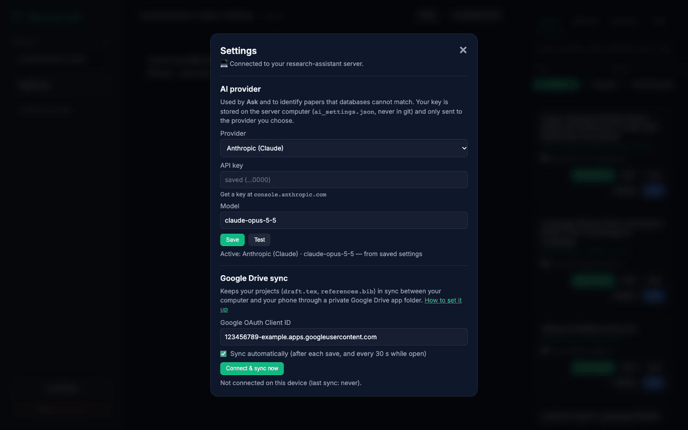
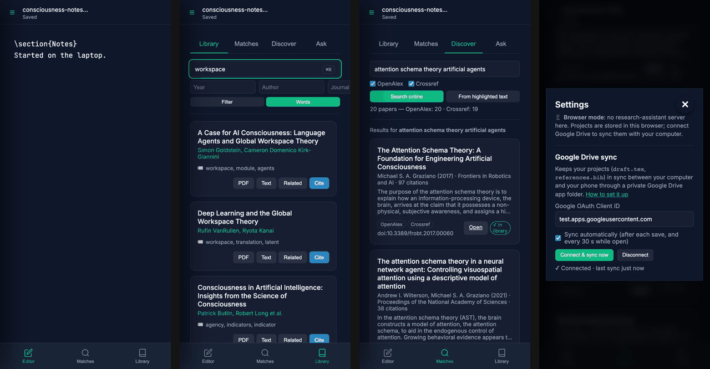

# AI provider, Google Drive sync and the phone page

Everything here is optional: the research assistant works without AI and without Google.

- [AI provider (API key)](#ai-provider-api-key)
- [Google Drive sync](#google-drive-sync)
- [Using it on your phone](#using-it-on-your-phone)
- [What syncs, and what stays on the computer](#what-syncs-and-what-stays-on-the-computer)

## AI provider (API key)

An AI provider powers two things:

- the **Ask** tab: a question answered from your own library (semantic search picks the
  most relevant papers, the model answers from their abstracts and cites them as [1], [2]…);
- identifying papers that neither arXiv nor Crossref can match (the model reads the first
  pages and proposes a DOI or title, which is then checked against Crossref).

Supported: **OpenAI, Google Gemini, Anthropic (Claude), Mistral, Groq, OpenRouter**, and any
OpenAI-compatible server (**Ollama, LM Studio, vLLM**…, also the lab cluster worker).

The simplest set-up is a key in `.env` (git-ignored); the provider is detected automatically:

```bash
GEMINI_API_KEY=...        # or OPENAI_API_KEY, ANTHROPIC_API_KEY, MISTRAL_API_KEY,
                          #    GROQ_API_KEY, OPENROUTER_API_KEY
```

To choose explicitly (and a model):

```bash
AI_PROVIDER=mistral       # openai | gemini | anthropic | mistral | groq | openrouter | custom | none
AI_MODEL=mistral-small-latest
AI_API_KEY=...            # optional when the provider's own variable above is set
AI_BASE_URL=http://localhost:11434/v1   # only for "custom" (e.g. Ollama)
```

Or use **⚙ Settings → AI provider** in the web page: choose the provider, paste the key,
**Save** and **Test**. These settings are stored in `ai_settings.json` next to your library
(git-ignored, readable only by you) and take precedence over `.env`. The page never receives
your key back (it only shows its last four characters).



The previous cluster set-up (`server_module/llm_worker.py`, started with `POST /api/chat/start`
or `sbatch`) still works and is used when no provider is configured.

## Google Drive sync

Projects (`draft.tex` and `references.bib`) are synced through a **private Google Drive app
folder**: a hidden folder only this app can read, which does not appear in your Drive. The
browser talks directly to Google; nothing goes through another server.

### One-time Google set-up (5 minutes)

1. Open [Google Cloud Console](https://console.cloud.google.com/), create a project (or reuse
   the one from ADHDtools).
2. **APIs & Services → Library**: enable the **Google Drive API**.
3. **APIs & Services → OAuth consent screen**: user type *External*, fill in the app name and
   your email, and add yourself under **Test users**.
4. **APIs & Services → Credentials → Create credentials → OAuth client ID**, type
   **Web application**. Under **Authorized JavaScript origins** add:
   - `http://localhost:8000` and `http://127.0.0.1:8000` (the server on your computer; use your
     port if you changed `PORT`)
   - `https://<your-github-name>.github.io` (the phone page, see below)
5. Copy the **Client ID** (it ends with `.apps.googleusercontent.com`). It is not a secret.

If you already use ADHDtools, you can reuse its Web client: just add the origins above.

### Connect

Paste the Client ID in **⚙ Settings → Google Drive sync** and click **Connect & sync now**
(or put `GOOGLE_CLIENT_ID=...` in `.env` so the page on your computer fills it in). Google asks
once for permission to "see, create and delete its own configuration data in your Google
Drive". Then, with **Sync automatically** on, the page syncs a few seconds after each save,
every 30 seconds while it is open, and when you come back to it. The sidebar shows
"☁ Synced …".

Sign-in tokens last about an hour; after that, open Settings and click **Connect & sync now**
again (Google does not ask for permission a second time).

### How conflicts are handled

Each file keeps its newest version. If the same file was changed on two devices between
two syncs, nothing is lost: the newer version stays in the project and the other one is
saved as a separate project named `<project> - conflict <date time>`, so you can compare and
copy what you need, then delete it. Deleting a project on one device deletes it everywhere
(edits made after the deletion win).

## Using it on your phone

The same page works without the server: open it from **GitHub Pages**.

1. On GitHub: repository **Settings → Pages → Source: GitHub Actions**. The *Pages* workflow
   publishes `frontend_module/` at `https://<your-github-name>.github.io/research-assistant/`
   on every push that changes it (or run it from the **Actions** tab).
2. On the phone, open that address (add it to the home screen), **⚙ Settings**, paste the same
   Client ID and **Connect & sync now**.

Without a server the page is in **browser mode**: projects are stored in the phone's browser
and synced through Drive.



## What syncs, and what stays on the computer

| | Computer (server) | Phone (browser mode) |
|---|---|---|
| Write `draft.tex` / `references.bib` | ✓ | ✓ (synced through Drive) |
| Library list, filters (year, author, journal) | ✓ | ✓ from the library index the computer copies to Drive |
| Word search | ✓ full text | ✓ titles, abstracts and keywords |
| Semantic search, highlight → Matches, Ask | ✓ | — (needs the embedding model and your AI key) |
| Read a paper | ✓ PDF and extracted text | abstract + link to the open PDF (arXiv / DOI) |
| Cite → `references.bib` | ✓ | ✓ (same keys and format, JavaScript port) |
| Discover (online search) | arXiv, OpenAlex, Semantic Scholar, Crossref | OpenAlex and Crossref (arXiv and Semantic Scholar refuse requests from web pages; OpenAlex also lists arXiv preprints) |
| Add to library | downloads the PDF now | queued in Drive; your computer downloads and indexes it at its next sync |
| Knowledge graph, Quick Graph | ✓ | — |

The library index (titles, authors, years, DOIs, keywords and abstracts; no PDFs or full
texts) is copied to Drive by the page open on your computer whenever the library changed. The
PDFs themselves are not synced; to share them between computers, keep the data in a Google
Drive for Desktop folder and set `DATA_DIR` to it.

Heavy processing (PDF text extraction, embeddings, the graph) stays in Python on the computer:
a 300-million-parameter embedding model is too large to download into a phone browser, and the
library PDFs are private, so they are never uploaded to a cloud runner.
