# Research Assistant — Tutorial

This tutorial walks through every feature using a real example: a library of
**39 papers on correlates of consciousness in artificial intelligence**, which
we then use to write a short **literature review in LaTeX**
([PDF](docs/examples/ai-consciousness-review/review.pdf) ·
[LaTeX](docs/examples/ai-consciousness-review/review.tex) ·
[BibTeX](docs/examples/ai-consciousness-review/references.bib)).

All screenshots and animations were captured from the running application.

---

## Contents

1. [Install](#1-install)
2. [Start the server and log in](#2-start-the-server-and-log-in)
3. [Build your library](#3-build-your-library)
4. [The writing interface](#4-the-writing-interface)
5. [Highlight → search → cite](#5-highlight--search--cite)
6. [Searching the library](#6-searching-the-library)
7. [Discover new papers online](#7-discover-new-papers-online)
8. [Quick Graph: a paper's neighbourhood](#8-quick-graph-a-papers-neighbourhood)
9. [Knowledge Graph explorer](#9-knowledge-graph-explorer)
10. [Worked example: a literature review](#10-worked-example-a-literature-review)
11. [Manuscript and grant quality checks](#11-manuscript-and-grant-quality-checks)
12. [Statistics page and mobile use](#12-statistics-page-and-mobile-use)
13. [Ask your library (AI provider)](#13-ask-your-library-ai-provider)
14. [Laptop and phone: Google Drive sync](#14-laptop-and-phone-google-drive-sync)
15. [Use it from Gemini (MCP)](#15-use-it-from-gemini-mcp)
16. [Command-line reference and troubleshooting](#16-command-line-reference-and-troubleshooting)

---

## 1. Install

```bash
git clone https://github.com/jobellet/research-assistant.git
cd research-assistant
conda env create -f environment.yml
conda activate ai_research_assistant
```

Optional settings go in a `.env` file at the repository root (it is
git-ignored, so keys never end up in the repository):

| Variable | Purpose |
|---|---|
| `SERVER_PASSWORD` | Password for the web interface. If unset, a random token is printed at start-up. |
| `HF_TOKEN` | Hugging Face token, needed once to download `google/embeddinggemma-300m`. |
| `GEMINI_API_KEY`, `OPENAI_API_KEY`, `ANTHROPIC_API_KEY`, `MISTRAL_API_KEY`, … | Optional AI provider for **Ask** (Section 13); or set it in ⚙ Settings. |
| `GOOGLE_CLIENT_ID` | Optional Google OAuth Web Client ID for Drive sync (Section 14). |
| `S2_API_KEY` | Optional [Semantic Scholar key](https://www.semanticscholar.org/product/api): higher rate limits for Discover and citation links. |
| `OPENALEX_API_KEY` | Optional OpenAlex key (higher rate limits). |
| `DATA_DIR` | Store `library/`, `inbox/` and `chroma_db/` elsewhere (e.g. a synced drive). |
| `PORT` | Server port (default `8000`). |

## 2. Start the server and log in

```bash
python -m server_module.main
```

Open **http://localhost:8000/ui/** and enter your `SERVER_PASSWORD` (or open
`http://localhost:8000/ui/?token=<password>` once; the token is then removed
from the address bar and remembered for the browser tab). On macOS you can
double-click `launch.command` instead.

| Address | Page |
|---|---|
| `/ui/` | Writing interface (editor, library, matches, discover) |
| `/ui/graph.html` | Knowledge Graph explorer |
| `/dashboard` | Backend Monitor (processing pipeline) |
| `/ui/stats.html` | Library statistics |
| `/docs` | Interactive API documentation (FastAPI) |

## 3. Build your library

There are four ways to add papers. All of them end in `inbox/`, which the
processing pipeline turns into indexed library entries.

1. **Drop PDFs into `inbox/`.**
2. **Import Zotero:** `python scripts/import_zotero.py` (auto-detects `~/Zotero/storage`).
3. **Google Drive:** `python scripts/gdrive_sync.py <folder_id>`.
4. **Discover tab / `python -m discovery_module`:** search arXiv, OpenAlex and
   Semantic Scholar and download open-access PDFs directly (Section 7).

To reproduce this tutorial's library (38 arXiv papers + 1 open-access article):

```bash
python scripts/fetch_demo_library.py
```

Then open the **Backend Monitor** (`/dashboard`) and click **Run Process**:

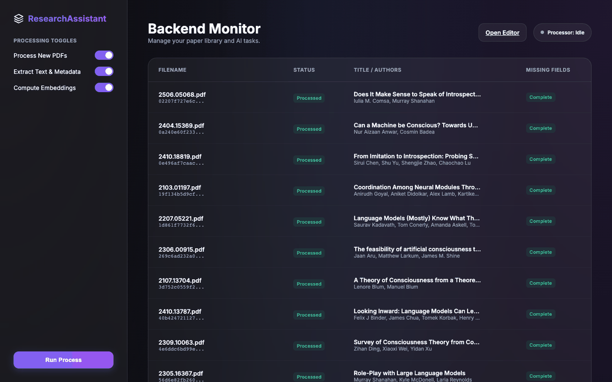

For each PDF the pipeline:

1. hashes it (SHA-256) and moves it to `library/<hash>/` — the same file is never processed twice;
2. extracts the full text and **verified metadata**: arXiv preprints are identified from the
   arXiv id (file name or first page); other papers through Crossref (DOI or title search,
   cross-checked against the PDF text). If no abstract is available, it is taken from the PDF;
3. rebuilds the **word-frequency index** and per-paper **TF-IDF keywords**;
4. computes **semantic embeddings** (ChromaDB);
5. refreshes the **knowledge graph** in the background.

The table shows each paper's status and any missing metadata fields. The
toggles on the left enable or disable individual steps (e.g. skip embeddings
on a slow laptop and compute them on another machine).

## 4. The writing interface

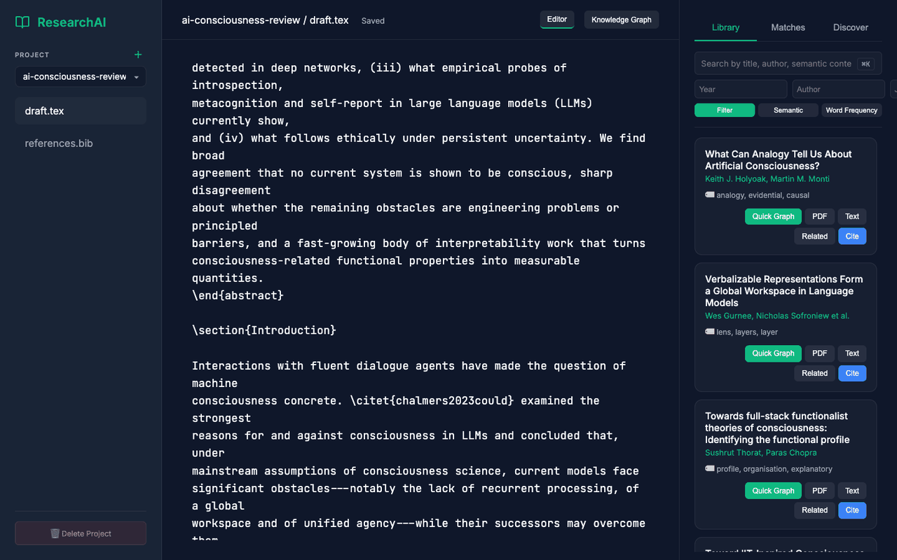

- **Projects** (left): each project is a folder `projects/<name>/` with a
  `draft.tex` and a `references.bib`. Use **+** to create one; the `default`
  project cannot be deleted.
- **Editor** (centre): plain-text LaTeX editor with auto-save ("Saved" next to
  the file name). It does not compile LaTeX: compile with your usual tool
  (`latexmk`, Overleaf, `tectonic`, …).
- **Side panel** (right): **Library** (all papers, search and filters),
  **Matches** (papers matching highlighted text) and **Discover** (online search).
- **Knowledge Graph** (top right) switches the centre panel to a graph of the library.

## 5. Highlight → search → cite

Write a sentence, **highlight it**, and the papers of your library that support
it appear in **Matches** (semantic search on the meaning of the sentence, not
on its words). **Cite** adds the paper to the project's `references.bib`; the
button then shows the `\cite{key}` command (click to copy it).

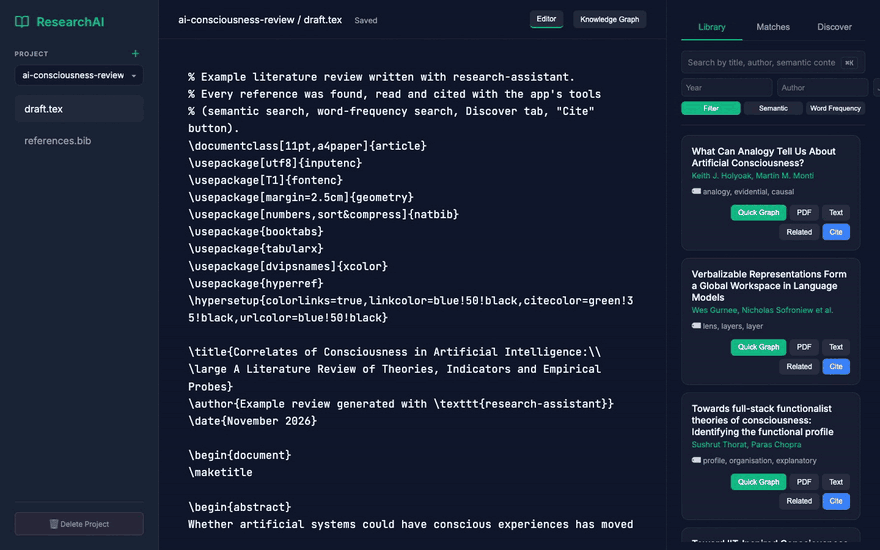

| Matches for the highlighted sentence | After clicking **Cite** | The generated `references.bib` |
|---|---|---|
| 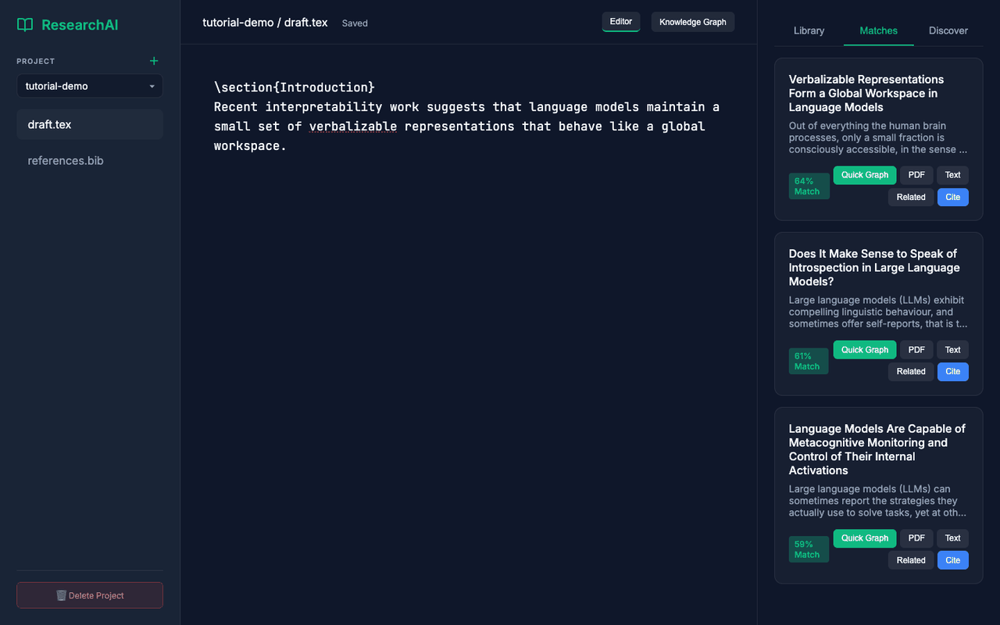 | 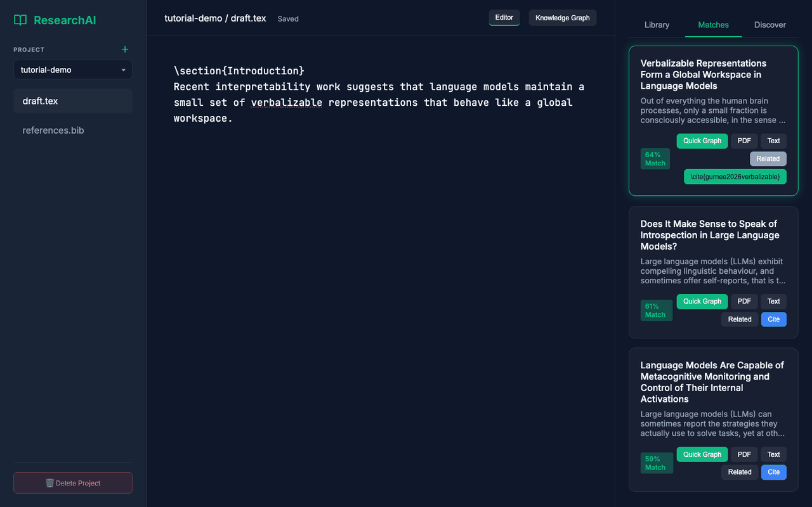 | 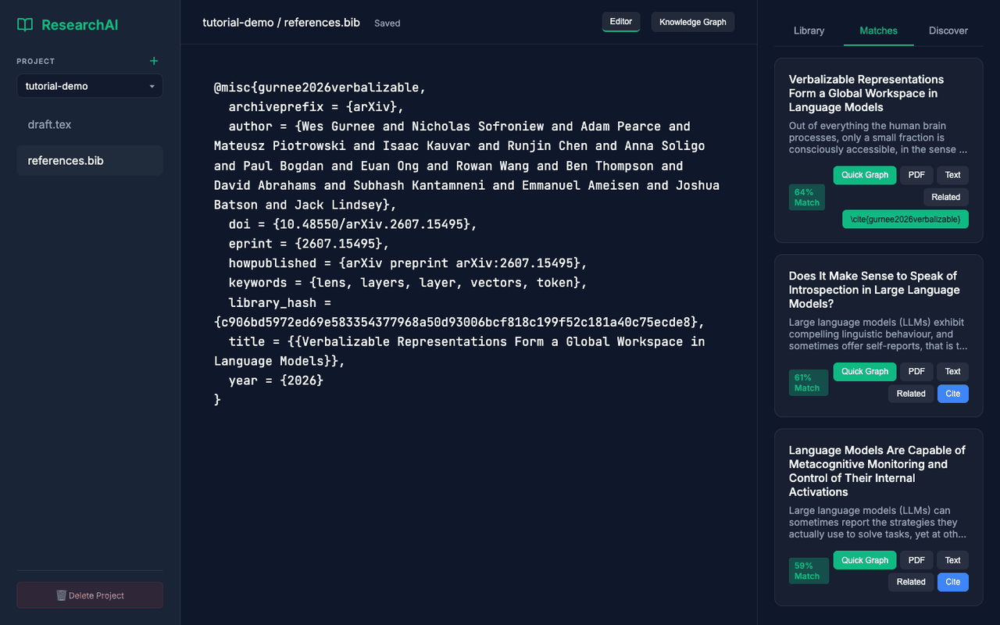 |

Citation keys look like `gurnee2026verbalizable` (first author, year, first
title word). Entries contain authors (joined with `and`), year, DOI, journal or
arXiv eprint fields. Citing the same paper twice returns the existing key
instead of duplicating the entry; two different papers by the same author in
the same year get `a`, `b`… suffixes.

## 6. Searching the library

The **Library** tab has three search modes:

| Mode | What it does | Example |
|---|---|---|
| **Filter** | Instant filtering by title/author text, year, author and journal | author = `Shanahan` |
| **Semantic** | Embedding search: finds papers about the same idea in different words | `language models introspection about their own internal states` |
| **Word Frequency** | Ranks papers by how often your words occur in their full text | `workspace` |

| Semantic search | Word frequency | Filter by author |
|---|---|---|
| 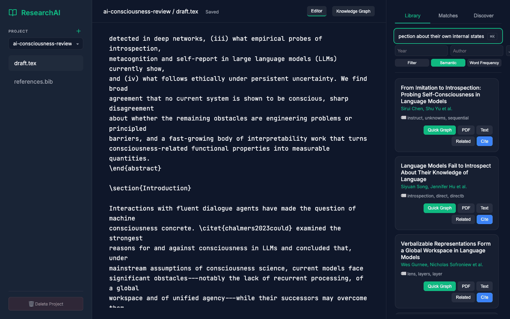 | 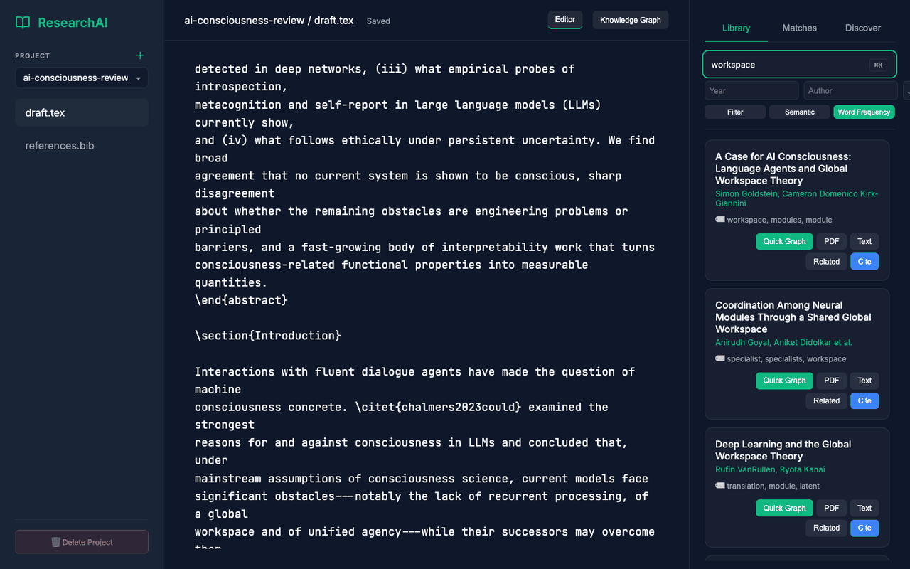 | 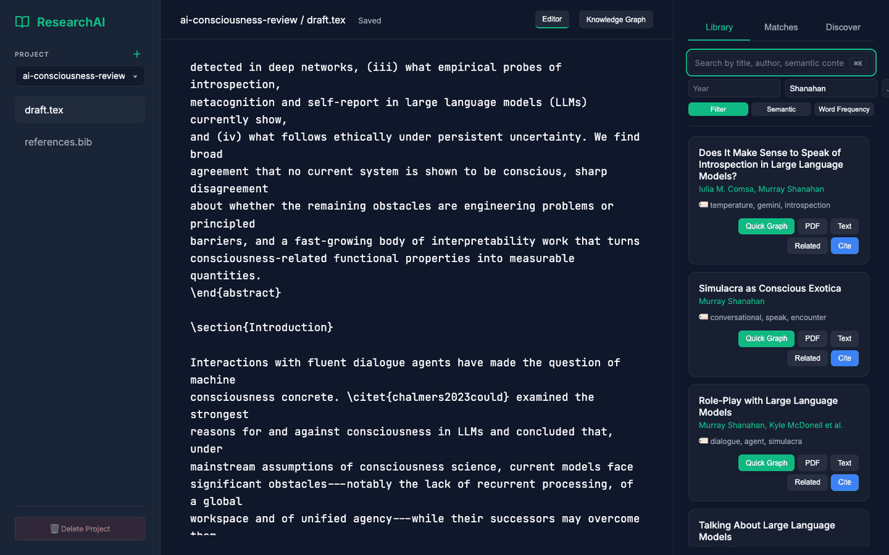 |

The modes complement each other. In the demo library, the semantic query
"integrated information theory causal structure" does not return the IIT 4.0
paper (its abstract is phrased differently), while the word-frequency query
`phi integrated` ranks it first.

Every card has buttons to open the **PDF**, the extracted **Text**, a
**Quick Graph** (Section 8), **Related** papers online (Section 7) and **Cite**.
Double-click a card to open its text.

| Text viewer | PDF viewer |
|---|---|
| 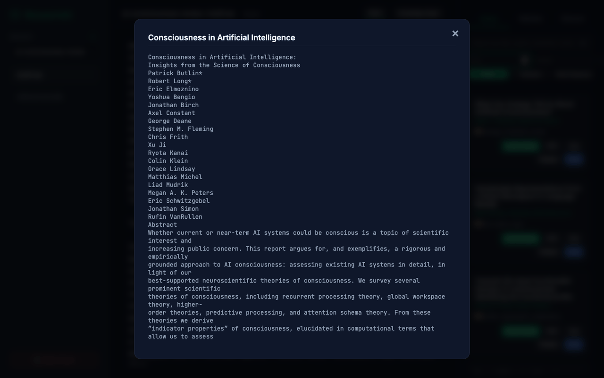 | 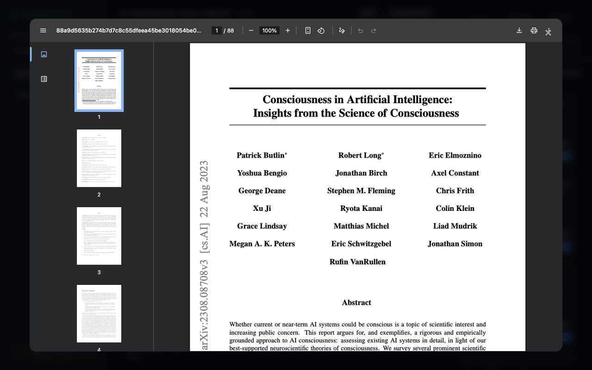 |

## 7. Discover new papers online

The **Discover** tab searches outside your library: **arXiv**, **OpenAlex**,
**Semantic Scholar** and optionally **Crossref**, in parallel. Results are
merged (the same paper found in several databases appears once, with one
badge per source), ranked, and marked **✓ in library** when you already have
them. **Add to library** downloads the open-access PDF into `inbox/` and starts
the pipeline, so the paper appears in the Library a minute later.

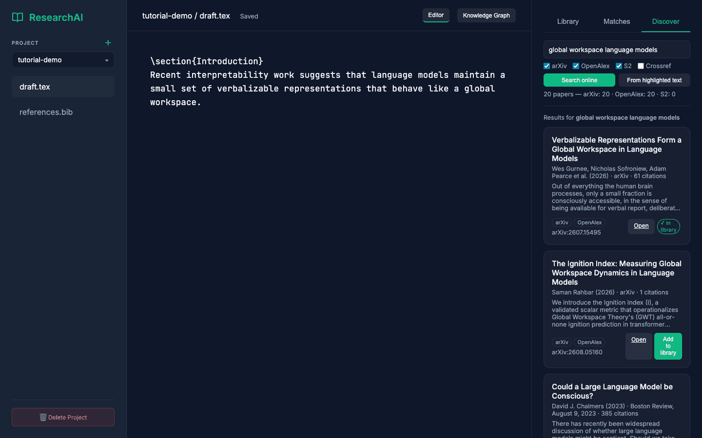

Two other entry points:

- **Related** (button on any library card) combines Semantic Scholar
  recommendations, papers citing the seed paper, OpenAlex related works and an
  arXiv search built from the paper's title and keywords.
- **From highlighted text** extracts the most distinctive terms of the
  sentence you highlighted in the editor and searches for literature on them.

| Related to Butlin et al. (2023) | From the highlighted sentence |
|---|---|
| 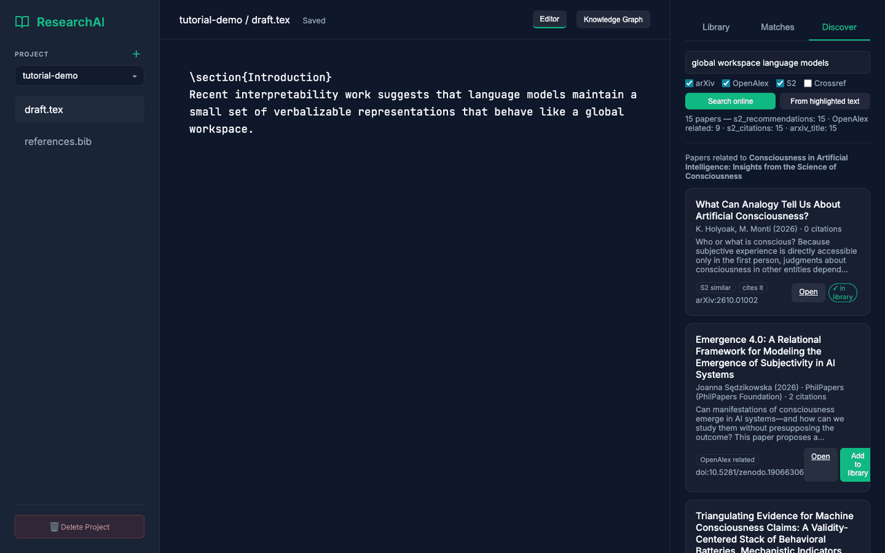 | 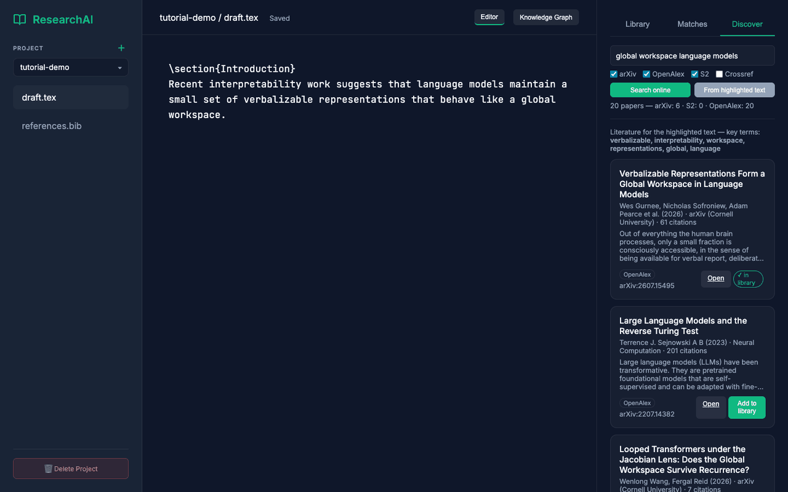 |

The same tools are available on the command line:

```bash
python -m discovery_module search "global workspace theory language agents"
python -m discovery_module related 2308.08708            # library hash, arXiv id or DOI
python -m discovery_module text "LLMs report subjective experience under self-reference"
python -m discovery_module fetch 2607.15495 2610.01002    # download into inbox/
python -m discovery_module search "attention schema" --fetch-top 3 --json
```

Public APIs limit request rates. Discover retries with back-off and reports how
many hits each source returned (e.g. `S2: 0` means Semantic Scholar was
rate-limited); set `S2_API_KEY` for reliable Semantic Scholar results.

## 8. Quick Graph: a paper's neighbourhood

**Quick Graph** opens the papers whose full text is most similar to the
selected one (word-frequency similarity). The selected paper is the large
orange node; each paper is linked to its five closest neighbours. Click a
node for details; drag to pan, scroll to zoom.

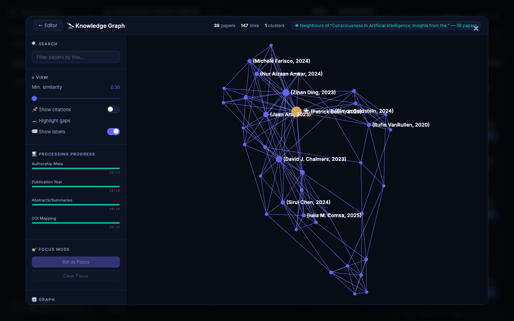

## 9. Knowledge Graph explorer

**Knowledge Graph → Advanced Explorer** (or `/ui/graph.html`) maps the whole
library: papers are placed by semantic similarity (UMAP), coloured by cluster
(HDBSCAN), and linked to their nearest neighbours.

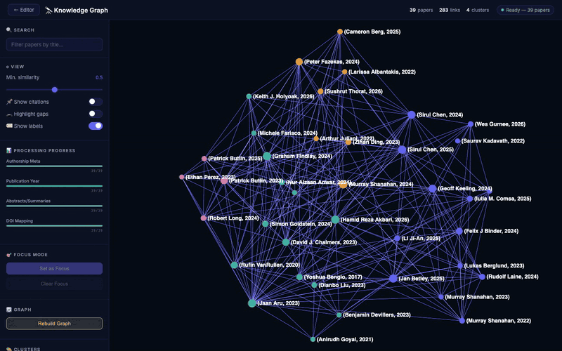

- **Clusters** (left panel) are named after the words most specific to them,
  here *models · llms · introspection*, *moral · agency*,
  *workspace · global · artificial* and *theory · conscious*. Click a cluster
  to highlight it.
- **Click a paper** to see its metadata, abstract, keywords, its most similar
  papers, **Open PDF** and **Add to Bibliography**.
- **Search** hides every paper whose title does not match.
- **Min. similarity** hides weaker links.
- **Show citations** overlays real citation links between your papers (orange),
  fetched from Semantic Scholar in the background the first time (about one
  second per paper).
- **Highlight gaps** lists *structural holes*: pairs of clusters that are
  semantically close but sparsely connected, i.e. literatures that could talk
  to each other more. Click a gap to isolate the two clusters; untick to restore.
- **Focus mode**: Shift-click several papers and **Set as Focus** to resize every
  paper by its similarity to their mean embedding.
- **Rebuild Graph** recomputes the layout (it is rebuilt automatically after new papers).

| Paper details | Citation links | Structural holes | Focus on 3 papers |
|---|---|---|---|
| 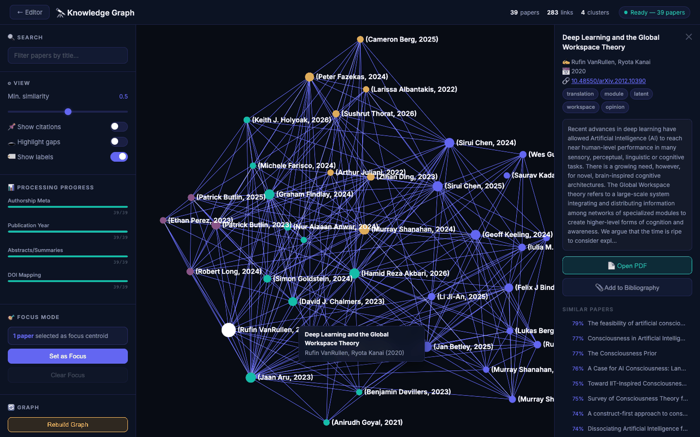 | 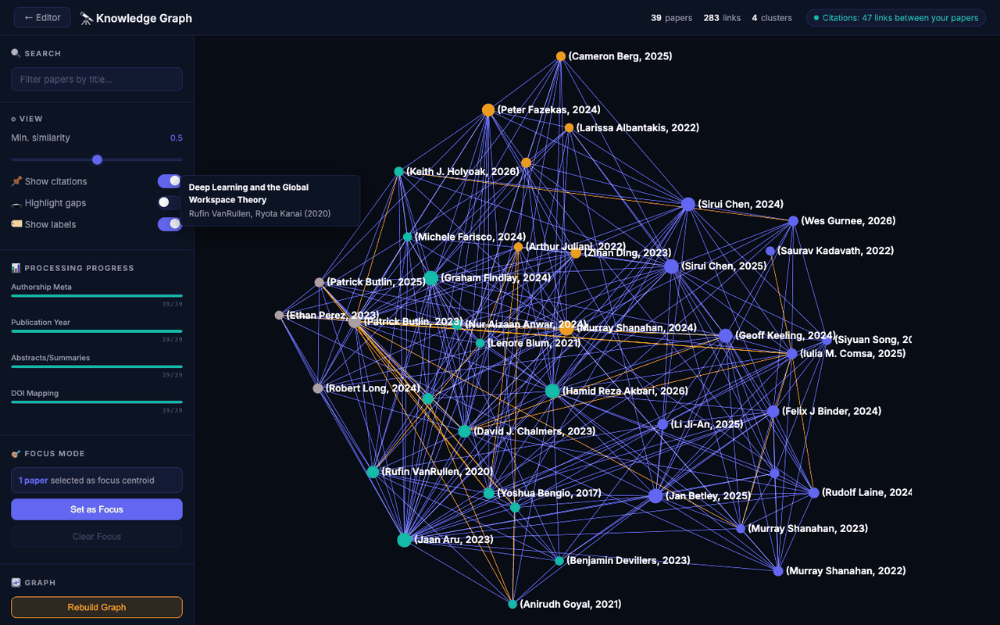 | 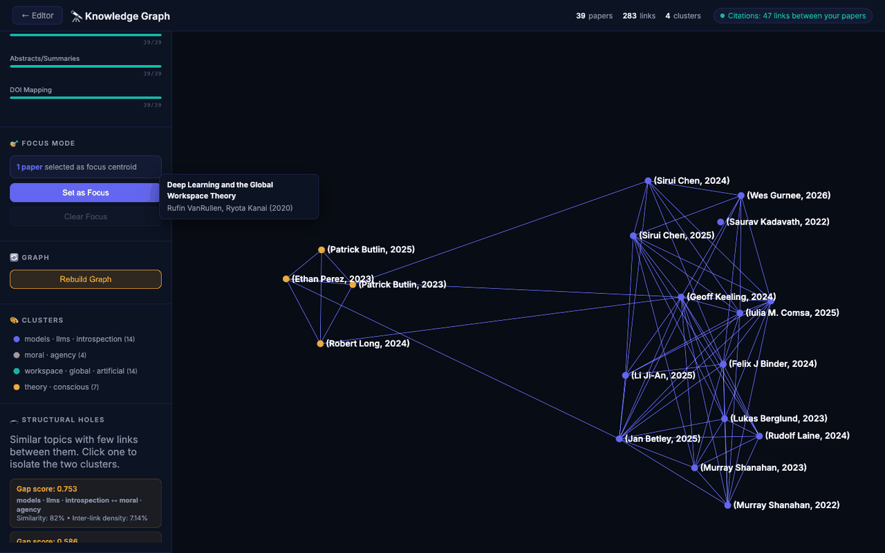 | 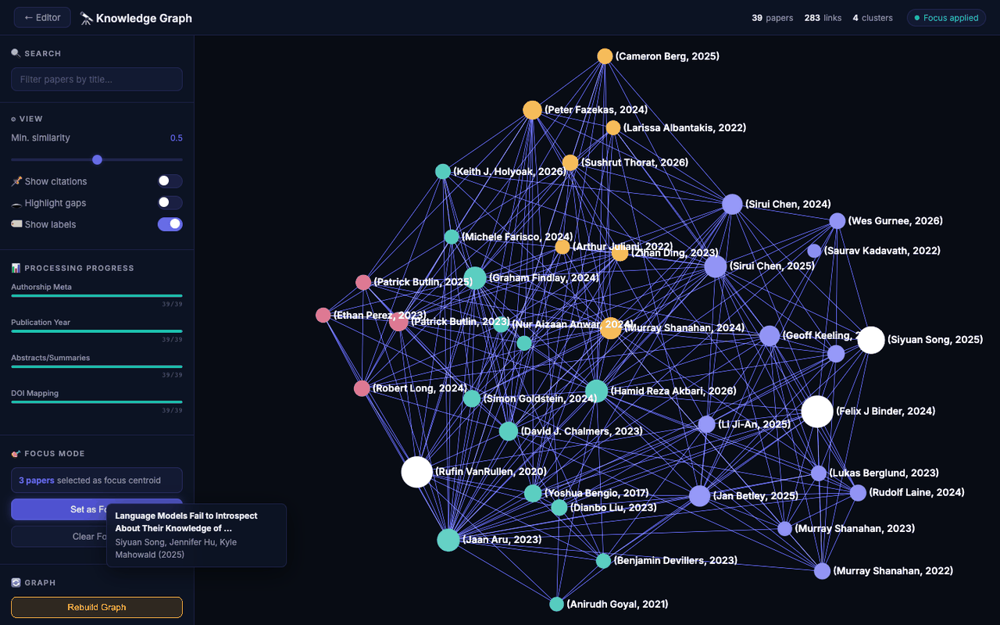 |

The editor's own **Knowledge Graph** tab shows a lighter force-directed view
of the same graph:

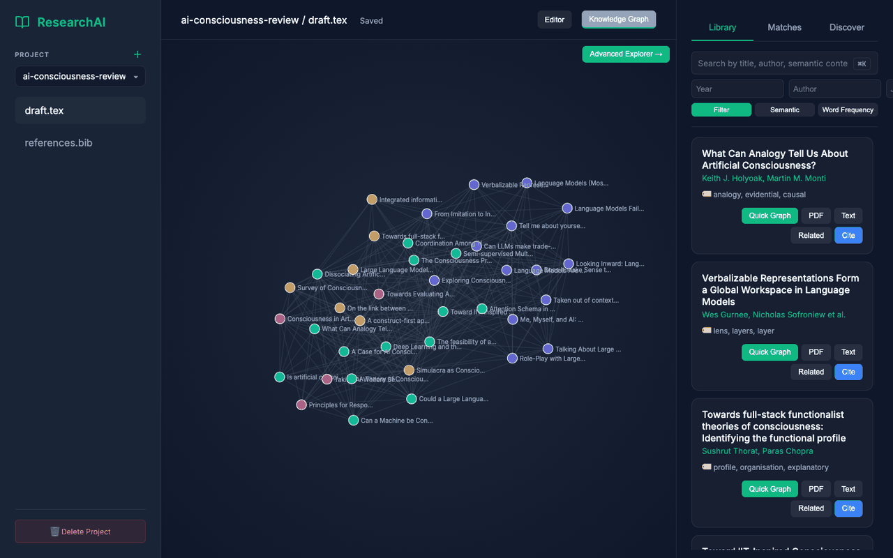

## 10. Worked example: a literature review

The review in [`docs/examples/ai-consciousness-review/`](docs/examples/ai-consciousness-review/)
was produced with the tools above:

1. **Seed papers.** Four PDFs on AI consciousness were dropped into `inbox/`.
2. **Expand the corpus.** 31 well-known arXiv papers on the topic were added
   by arXiv identifier (the same as `python -m discovery_module fetch <ids>`), and
   **Related** on Butlin et al. (2023) plus a Discover search on "global
   workspace theory language agents" found four recent papers
   (`python -m discovery_module related 2308.08708`), bringing the library to
   39 papers (list in `scripts/fetch_demo_library.py`).
3. **Map the field.** The Knowledge Graph's clusters (*models · llms ·
   introspection*, *moral · agency*, *workspace · global*, *theory ·
   conscious*) are close to the review's main sections, and its structural
   holes point to literatures that rarely cite each other — material for the
   synthesis section.
4. **Collect evidence per section** with semantic searches such as
   *"theory-derived indicator properties for assessing consciousness in AI
   systems"* or *"self-reports of subjective experience by language models"*,
   and word-frequency searches (`workspace`, `introspection`, `phi integrated`).
   The **Text** viewer was used to check each claim against the paper.
5. **Cite while writing**: every reference was added with **Cite**, which wrote
   the [`references.bib`](docs/examples/ai-consciousness-review/references.bib).
6. **Compile** with any LaTeX tool, e.g. `tectonic review.tex`.

## 11. Manuscript and grant quality checks

The **grounded claim audit** compares each sentence of a draft with the
analysis/results text you supply, flags absolute or unsupported statements and
numerical contradictions, and shows the best evidence sentence for each claim
(`POST /api/audit/claims`, or `audit_module.audit_claims`). It runs locally and
never invents evidence.

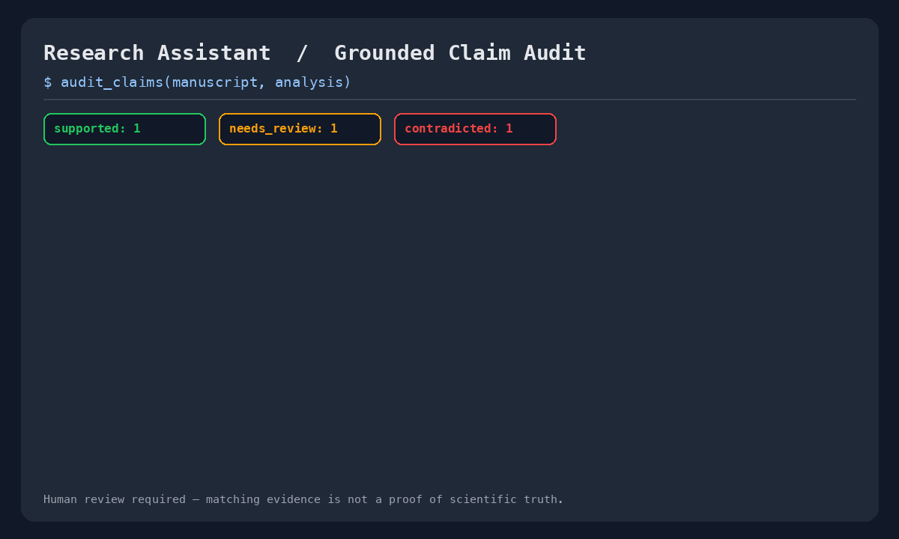

Other checks (all local, command line):

```bash
python -m audit_module.prose_auditor draft.txt      # connectives, voice, rhythm, spelling consistency
python -m audit_module.number_auditor draft.txt --horizon 36   # quantities, sums, ranges, timeline
python -m toolkit_module.schedule_generator         # DFG-style work schedule (Gantt) PNG
python -m toolkit_module.pdf_comments review.pdf    # extract reviewer comments from a PDF
python -m toolkit_module.figure_fit figure.png      # how much page a figure will take
```

## 12. Statistics page and mobile use

`/ui/stats.html` summarises processing progress (papers, metadata, text, DOIs).
On a phone, the interface switches to a bottom navigation bar (Editor,
Matches, Library, Graph).

| Statistics | Mobile |
|---|---|
| 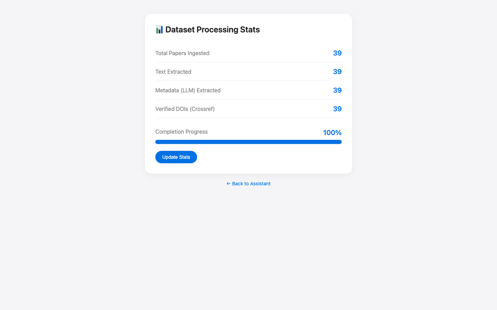 | 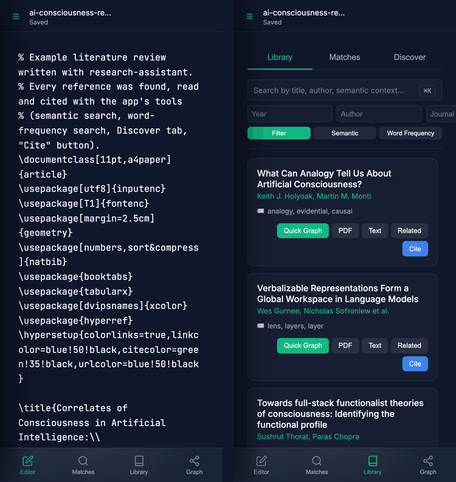 |

## 13. Ask your library (AI provider)

With an API key from any provider (OpenAI, Gemini, Claude, Mistral, Groq, OpenRouter) or a
local Ollama server, the **Ask** tab answers a question from your own papers: semantic search
picks the eight most relevant papers, the model answers from their abstracts, weighs the
evidence for and against, and cites them as [1], [2]… (click a number to jump to the source;
**Text**, **PDF** and **Cite** work on each source). **Use highlighted text** asks what your
library says about the sentence selected in the editor.

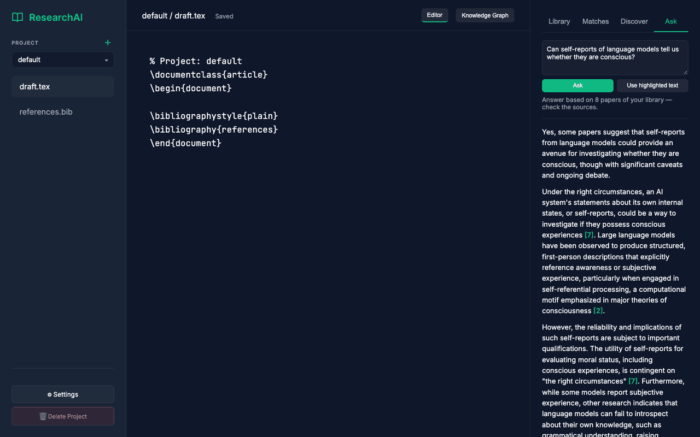

Put a key in `.env` (e.g. `GEMINI_API_KEY=…`; the provider is detected automatically) or use
**⚙ Settings → AI provider** (bottom of the left sidebar), then **Test**. The same provider is
used to identify papers that neither arXiv nor Crossref can match. Details:
[docs/sync-and-ai.md](docs/sync-and-ai.md#ai-provider-api-key).

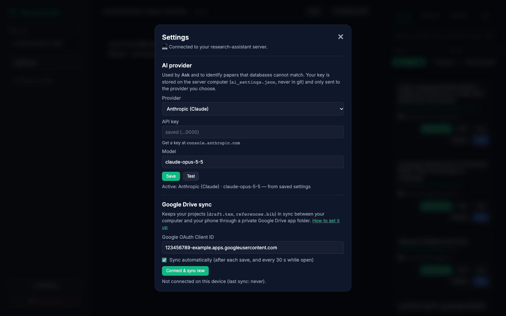

## 14. Laptop and phone: Google Drive sync

Start a draft on the laptop and continue on your phone. Projects (`draft.tex`,
`references.bib`) sync through a private Google Drive app folder; the same web page, published
on GitHub Pages, works on the phone without the server ("browser mode"): you can write, browse
and word-search your library, read abstracts, cite into `references.bib`, search OpenAlex and
Crossref, and queue papers that your computer adds to the library at its next sync. Semantic
search, Ask and the graph need the computer.

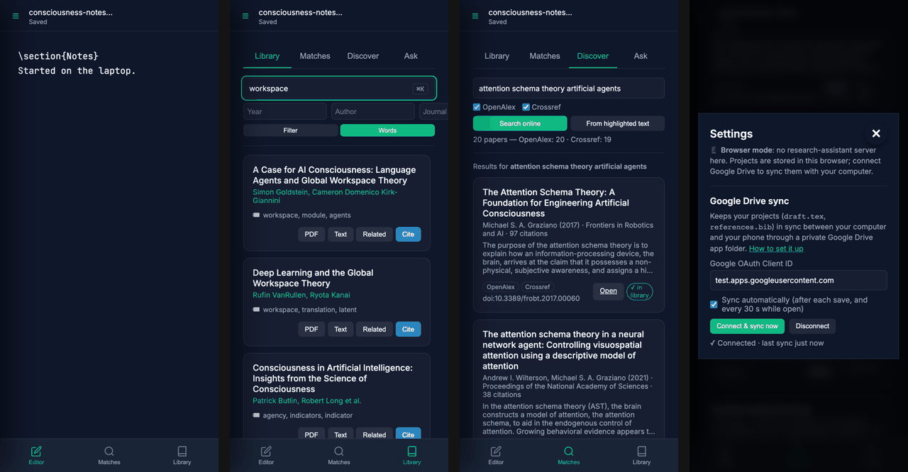

Set-up (Google OAuth Client ID, GitHub Pages) and conflict handling:
[docs/sync-and-ai.md](docs/sync-and-ai.md#google-drive-sync).

## 15. Use it from Gemini (MCP)

Gemini can call your research assistant as a tool: literature search, and optionally your own library.
A small separate server (`python -m mcp_module --tunnel`) and a free Cloudflare quick tunnel (no account) make it reachable;
the code runs on your computer. Read-only; the default mode never touches your library.

```bash
python -m mcp_module --tunnel      # prints an https://….trycloudflare.com/mcp/<secret> address
```

Paste that address in Gemini: **Connectors → + Custom → Next → Connect**. Full step-by-step guide, library mode, privacy
notes and troubleshooting: [docs/mcp.md](docs/mcp.md).

## 16. Command-line reference and troubleshooting

| Command | Purpose |
|---|---|
| `python -m server_module.main` | Start the server (`PORT`, `SERVER_PASSWORD` from the environment or `.env`). |
| `python scripts/fetch_demo_library.py` | Download this tutorial's 39 papers into `inbox/`. |
| `python -m discovery_module …` | Online literature search / related papers / downloads (Section 7). |
| `python scripts/generate_bow.py [--update-db]` | Rebuild the word-frequency index and TF-IDF keywords (done automatically by the pipeline). |
| `python scripts/build_graph.py` | Pre-compute the knowledge graph and citation links (e.g. on a faster machine). |
| `python scripts/search_bow.py "keyword"` | Word-frequency search without starting the server. |
| `python run_search.py` | Desktop (Tkinter) search window. |
| `python -m pytest` | Run the test suite. |

**Troubleshooting**

- *"Error loading library"*: the password was wrong or the prompt was
  dismissed — reload the page, or open `/ui/?token=<password>`.
- *Word Frequency search or Quick Graph is empty*: the word index is built
  after processing; for libraries imported by other means run
  `python scripts/generate_bow.py`.
- *Knowledge graph shows "No papers in library yet"*: run the pipeline first;
  the graph is rebuilt automatically when it finishes (or click **Rebuild Graph**).
- *Discover returns few results / `S2: 0`*: a public API is rate-limiting you;
  wait a minute or add `S2_API_KEY` / `OPENALEX_API_KEY` to `.env`.
- *"Another instance running?"*: a previous server is still running (or left
  `server.lock` behind after a crash); stop it or delete `server.lock`.
